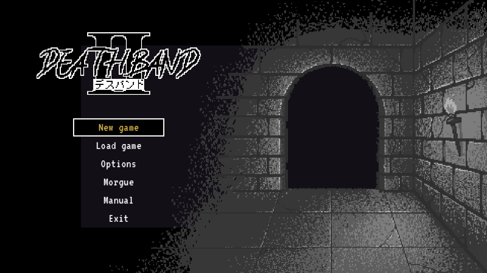
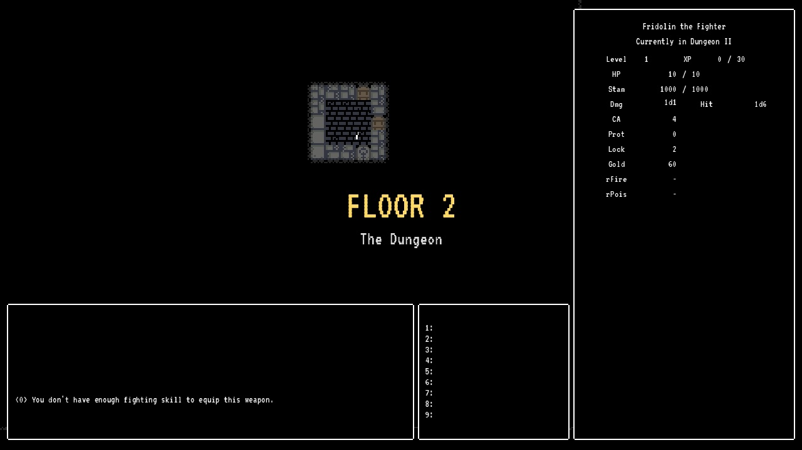
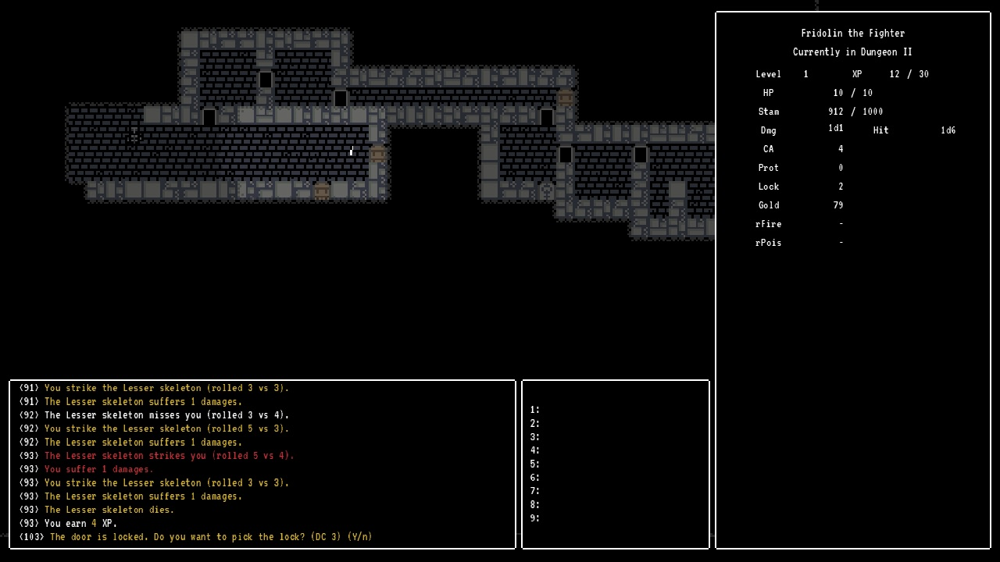
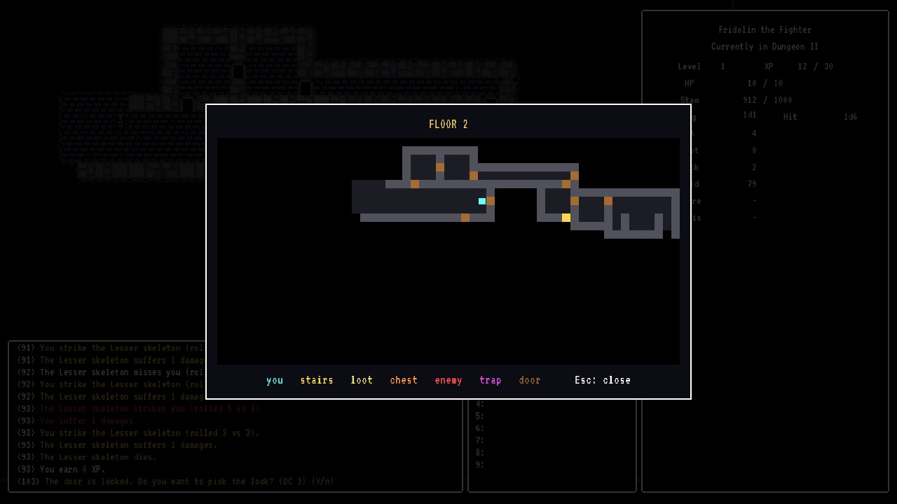
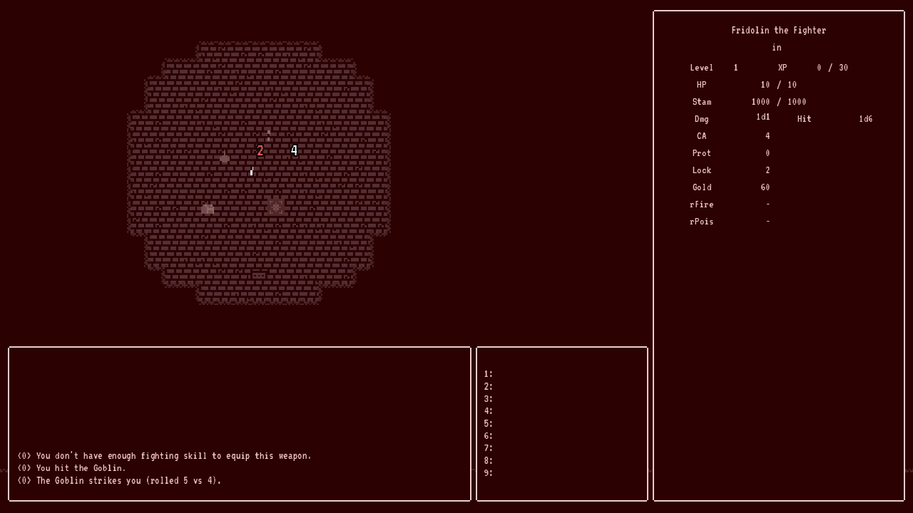
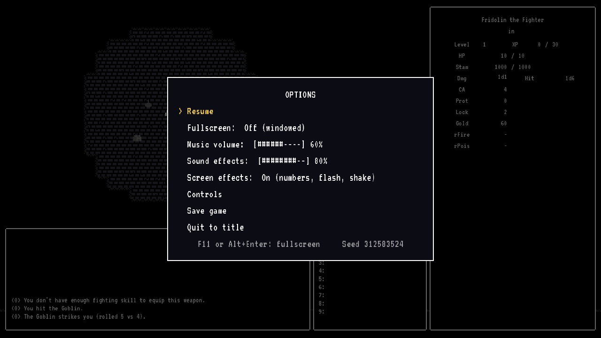
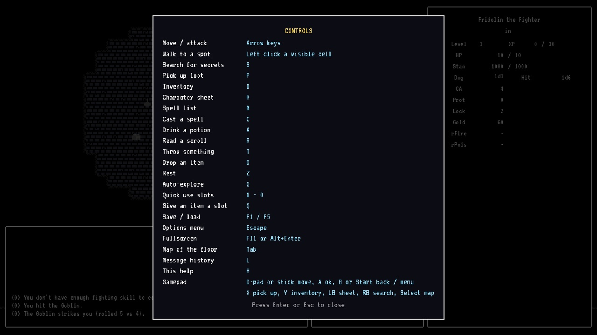
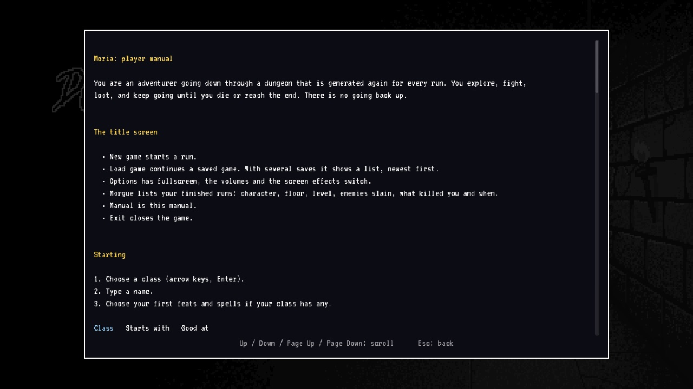

# Moria

Roguelike remake of the original Dungeons of Moria (1983) by Robert Alan Koeneke & Jimmey Wayne Todd.
Turn based, one hit point total, a new dungeon every run, played with the keyboard (and a mouse click to walk).

New here? Read [MANUAL.md](MANUAL.md). In the game, press **H** for the controls.

## Screenshots

| | |
|---|---|
|  |  |
| Title screen: New game, Load game, Options, Morgue, Manual, Exit | Taking the stairs: the floor title card |
|  |  |
| Exploring, with the combat log | The map of the whole floor (Tab) |
|  |  |
| Hit and damage numbers, red flash when hurt | Options menu (Esc) |
|  |  |
| Controls (H) | The manual, readable from the title screen |

The screenshots were taken with stand-in art for the files that are missing from the repository (see Known issue
below): monsters are not drawn as sprites in them, and the font and some of the wall tiles are placeholders. The
title screen, the room tiles, the panels and the effects are the real ones.

## Run it

- Needs **Godot 3.6** (tested with 3.6.3). It is a Godot 3 project, Godot 4 will not open it correctly.
- Open `project.godot` in Godot and press F5, or run `godot --path .` from this folder.
- The game starts on the title screen (New game, Load game, Options, Morgue, Manual, Exit) and in a window. **F11** or **Alt+Enter** switches to fullscreen, **Esc** opens the options menu.

## Tests

The tests are part of the game: they play it with faked input and check what happened.

1. Open `scenes/Game.tscn` and set the `Game` node's **Start** to `Tests` (and **Tests** to `All`, `Move` or `Inventory`).
2. Run that scene (`Run Current Scene`, F6, with `Game.tscn` open). It prints each test and quits when done. A failed check shows as `Assertion failed`.

Headless, for CI: `MORIA_NO_SAVE=1 godot --path . --no-window scenes/Game.tscn` after setting Start to `Tests` (do not commit that change).
`MORIA_NO_SAVE=1` keeps tests and bots from writing your real settings and saves.

## Debug keys

`/` skips to the next floor. It is off in normal play: switch on `debugMode` on the `Game` node or run with
`MORIA_DEBUG=1`.

## Folders

| Folder | What is in it |
|---|---|
| `scripts/` | All the code. `engine/` the rules (spells, auras, items, sound, settings, effects), `menu/` and `ui/` the screens (the title screen is `ui/TitleScreen.gd`), `utils/` helpers, the save system and the morgue |
| `scenes/` | Godot scenes |
| `data/` | Classes and monsters as CSV |
| `tests/` | The test harness and the tests |
| `sounds/` | Sound effects and music, see `sounds/README.md` |
| `tools/` | `sid_audio.py` makes the sounds and the built-in music (python3, numpy and sox) |

## Saves and settings

Saves and settings are in Godot's user data folder, not in the project, so they also work in an exported game:

| System | Folder |
|---|---|
| macOS | `~/Library/Application Support/Godot/app_userdata/Moria/` |
| Windows | `%APPDATA%\Godot\app_userdata\Moria\` |
| Linux | `~/.local/share/godot/app_userdata/Moria/` |

`saves/<name>.sav` is the save (the game also saves when you take the stairs), `morgue.json` is the record of finished runs (title screen: Morgue), `settings.cfg` has fullscreen, the
volumes and the screen effects switch. Put your own songs in `music/` in the same folder, see `sounds/music/README.md`.

## Floor size

Floors are 55 x 27 cells (`GLOBAL.FLOOR_SIZE_X/Y`), the screen shows 37 x 19 of them and the camera follows the
character. Monsters, loot, chests and traps scale with the area (`GLOBAL.CONTENT_SCALE`). Saves made with the old
37 x 19 floors cannot be loaded, the game says so instead of failing.

## Music and sound

The sound effects and the fallback music are made with a software model of the Commodore 64's SID chip
(`tools/sidsynth.py`). The three songs in `sounds/music/` were made with Suno from the prompts in
`sounds/music/SUNO_PROMPTS.md`. To use other songs, replace the files, the README there says how.

## Known issue

`sprites/`, `fonts/` and `assets/` are listed in `.gitignore`, so a fresh clone is missing a few files that the
scenes load (`sprites/chars_full.png`, `sprites/walls-basic.png`, `sprites/title_gate_*.png`, `fonts/alagard.tres`
and `fonts/Perfect DOS VGA 437.ttf`) and Godot will report them as missing. Add them to the repository (or remove
the folders from `.gitignore`) to run from a clean clone.
